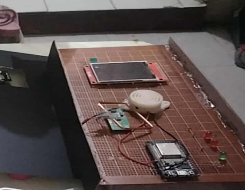
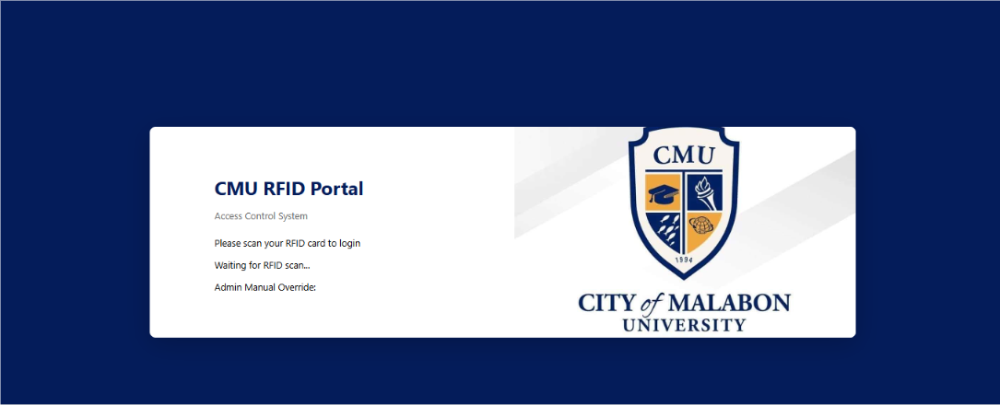
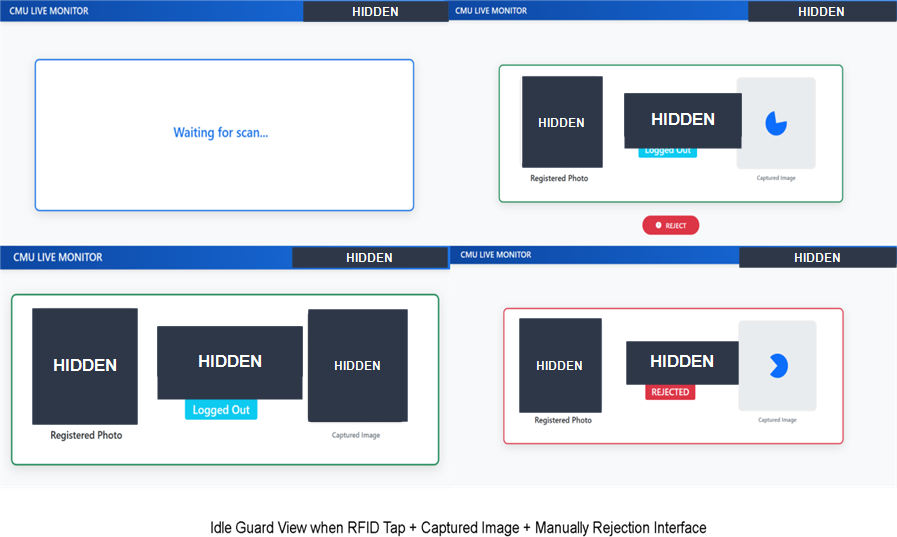
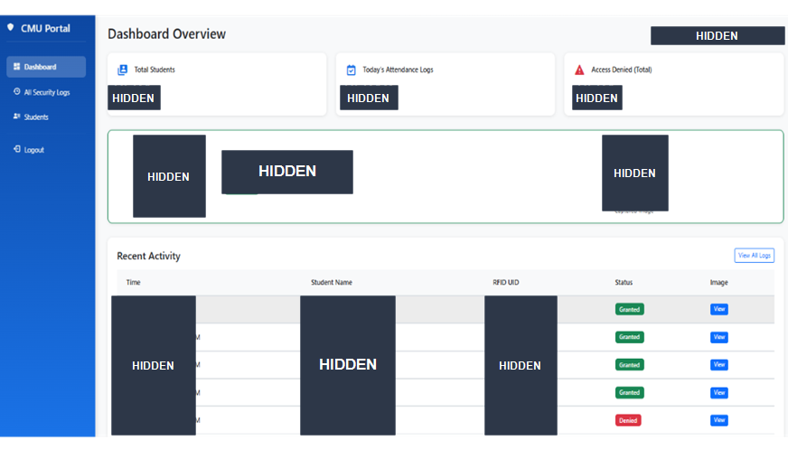
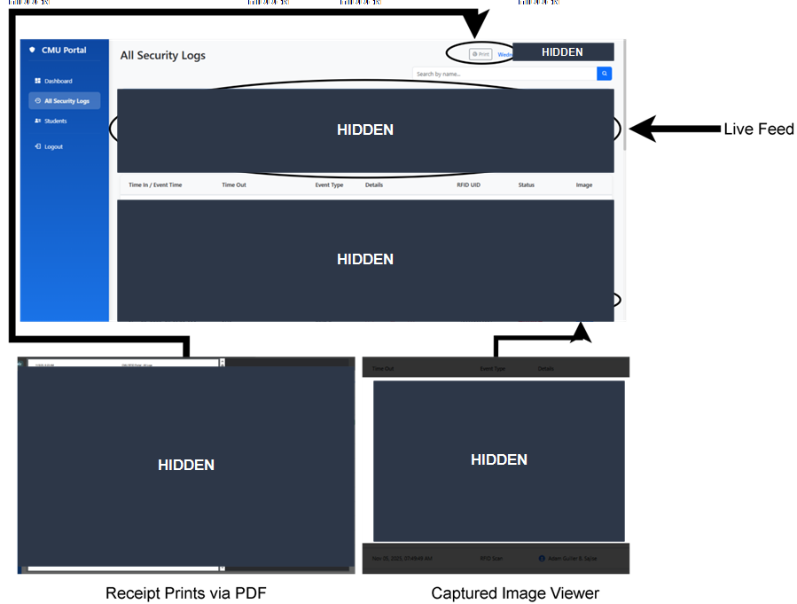
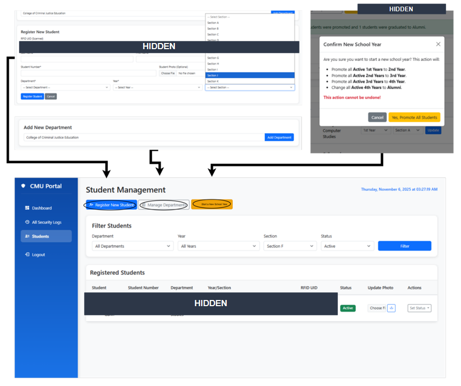
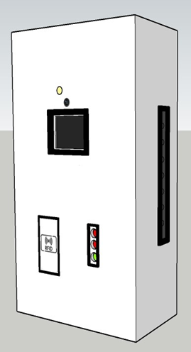
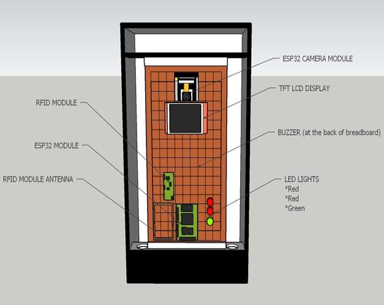

# RFID-Based Student Monitoring with Real-Time Alerts

An academic prototype that combines RFID-based student identification, an ESP32 hardware terminal, and a PHP/MySQL web portal to record campus entry events and notify security staff about denied or suspicious access.

> **Privacy and safety:** This repository is intended for demonstration and academic use. Do not publish student records, RFID UIDs, Wi-Fi credentials, camera captures, or database exports. The system handles personal information and is not designed for exposure to the public internet. Use test data and a trusted local network.

## System overview

- Students present an RFID card to the ESP32 terminal.
- The reader sends the tag to the PHP backend for verification against the MySQL database.
- The terminal provides local status using a TFT display, LEDs, and a buzzer.
- The portal records attendance and access events for administrators and security personnel.
- Motion and access events can trigger alerts in the portal.
- The ESP32 can discover the portal server on the local network using UDP; the sketch also supports a configured fallback server address.

### Hardware prototype

The prototype combines an ESP32, RFID reader, display, camera module, and status indicators.



### Portal sign-in screen

This manuscript illustration is cropped to omit the local IP address and session details.



### Live monitoring interface

Student names, faces, and timestamps are hidden in this documentation copy.



### Administrator dashboard

Student names, faces, RFID UIDs, activity timestamps, and sample counts are hidden.



### Access logs

Student identities, RFID UIDs, timestamps, and captured images are hidden.



### Student management

The sample student's identifying details, scanned UID, and timestamp are hidden.



## Technology

- **Hardware firmware:** ESP32 Arduino C++
- **Portal:** PHP, HTML, CSS, and JavaScript
- **Database:** MySQL
- **Network:** HTTP requests and UDP discovery on a local network

The repository retains the bundled third-party libraries used by the firmware. Unused bundled libraries and vendor examples/tests are excluded to keep the repository smaller. Each included third-party library retains its own license.

## Hardware concept and component layout

These manuscript illustrations show the enclosure concept and the hardware component arrangement.





## Repository layout

```text
CMU_RFID_PORTAL_READY/
├── css/                         Portal styles
├── html/                        Portal entry pages
├── javascript/                  Browser-side portal code
├── pages/                       Dashboard and management screens
├── php/                         API endpoints and database connectors
├── sql/schema.sql               Schema-only database setup
├── esp32/RFID_PROTOTYPE/        ESP32 sketches and local headers
└── docs/images/                 Privacy-reviewed project illustrations
```

Runtime data, uploaded images, backup files, obsolete sketches, and the original database export are intentionally excluded from Git because they may contain personal information or credentials. Screenshots in this README have identifying details redacted.

## Requirements

- XAMPP (Apache, PHP with PDO MySQL and MySQLi extensions, and MySQL/MariaDB), or an equivalent local PHP/MySQL environment
- Arduino IDE with ESP32 board support
- The Arduino libraries used by the firmware, including TFT_eSPI, Adafruit GFX, ArduinoJson, ESP32 Async UDP, and TJpg_Decoder
- An ESP32, compatible RFID reader, and the other hardware modules wired for the prototype

## Local setup

1. Clone or download this repository into the web server's document root (for example, `C:\xampp\htdocs\portal`).
2. Create a database named `cmu_rfid_portal`, then import [`sql/schema.sql`](sql/schema.sql). This file defines tables only; it contains no student data or credentials.
3. Configure the PHP runtime with `DB_HOST`, `DB_USER`, `DB_PASSWORD`, `DB_NAME`, and `ADMIN_RFID_UID`. The administrator RFID UID is required for administrator-tag login and alert clearing. The PHP connectors use local XAMPP defaults when database variables are not set; never use those defaults on a public server.
4. Open the portal from a browser on the same trusted network as the ESP32 and configure the terminal to use that server.
5. In each ESP32 sketch folder, copy `secrets.h.example` to `secrets.h` and set your own Wi-Fi network, fallback server address, and authorized administrator RFID UID where applicable. These local `secrets.h` files are ignored by Git.
6. Open the required `.ino` file in Arduino IDE, install the required libraries, select the matching ESP32 board and port, then build and upload the sketch.

## Hardware and network notes

Pin assignments, peripheral settings, and supported board variants are defined in the firmware and its included headers. Confirm wiring against the actual prototype before powering it. The web portal and terminal are designed for a controlled local network; the firmware uses HTTP and should not be exposed directly to the internet.

## License

No project-level license has been assigned. Third-party libraries in `esp32/libraries/` retain their own licenses.
